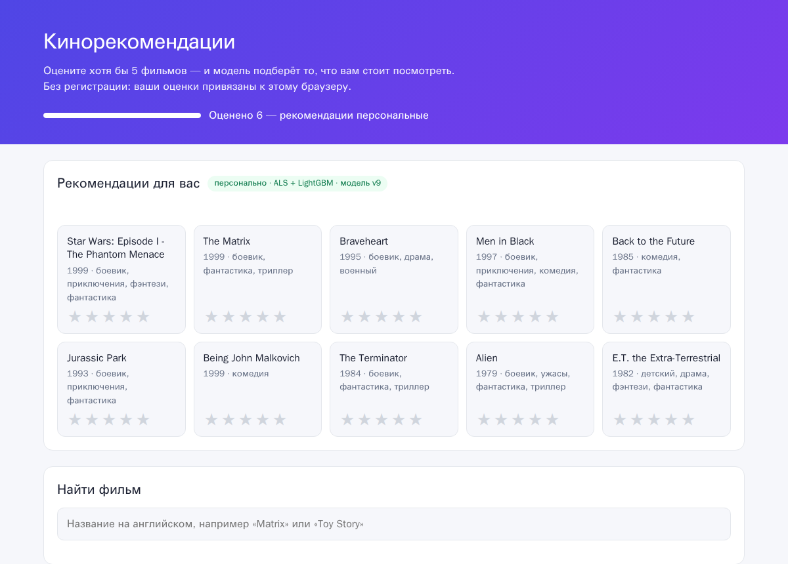
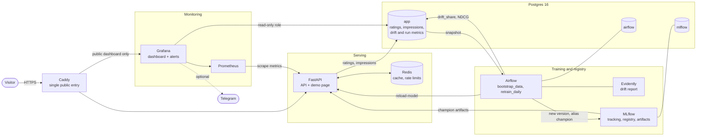
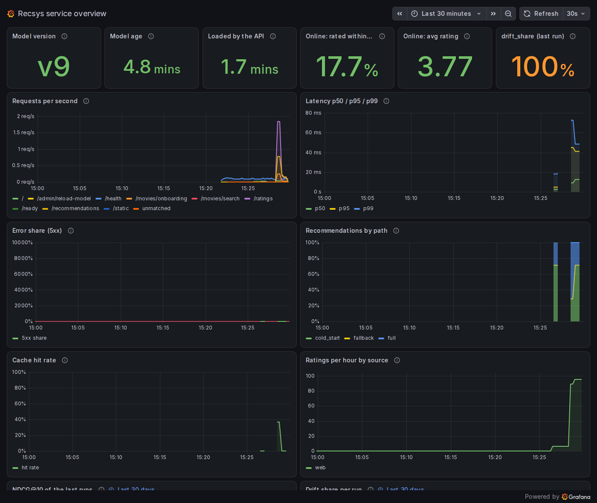

# MovieLens recommender: two-stage recsys with a full MLOps loop

[](https://github.com/mark37mur-ops/recommended_system_pipeline_petproject/actions/workflows/ci.yml)
[](https://github.com/mark37mur-ops/recommended_system_pipeline_petproject/actions/workflows/deploy.yml)


A movie recommender on MovieLens 1M, built as a working system: ALS candidates re-ranked by
LightGBM (lambdarank), served by FastAPI with a small demo page. Visitors rate movies
anonymously and get recommendations right away; their ratings go into a daily Airflow retrain.
The retrain evaluates the new model and the current champion on the same split and moves the
MLflow `champion` alias only if the challenger holds up; the API then hot-reloads it.
Prometheus, Grafana and Evidently watch the service, the online quality and data drift.
Everything runs in `docker compose`, locally and on one server behind Caddy. The CI pipeline
publishes images to GHCR, and a deploy workflow with automatic rollback is ready for a server.



## Architecture



**Online path:** `POST /ratings` → Postgres → `GET /recommendations` → ALS fold-in for the
visitor → LightGBM re-ranks ~100 candidates → top 10 (Redis cache, invalidated by the next
rating). 0 ratings: onboarding; 1–4 ratings: popular in the liked genres; 5+: the full model.

**Offline path (`retrain_daily`, daily):**
`extract_ratings → validate_data → drift_report → split → train_als → train_ranker → evaluate → decide_promotion → promote → set_champion_alias → reload_api` (or `skip → log_reason`).

## What it demonstrates

- **Two-stage recommender:** `implicit` ALS generates 100 candidates, a LightGBM `LGBMRanker`
  (lambdarank) re-ranks them with ALS score/rank, movie, user and user-genre affinity features.
- **Leakage-free evaluation:** per-user temporal split (`[ALS train | next 5 → ranker train | last 5 → test]`).
  Ranker candidates come from an ALS fitted on the first part only; the registered model is
  exactly the evaluated one. Baselines: popularity → ALS-only → ALS + ranker.
- **Train/serve parity:** one `recsys.features` module for training and the API; the pyfunc
  model takes raw ratings, so any visitor is served through fold-in.
- **Model registry with a promotion gate:** MLflow aliases (no deprecated stages). The
  challenger is promoted if its NDCG@10 ≥ champion − 0.005, coverage drops ≤ 10% and it beats
  popularity. The champion is re-scored through fold-in **on the challenger's split**.
- **Live feedback loop with cold start:** anonymous signed-cookie visitors, ratings with quotas
  and rate limits, recommendations in tens of milliseconds, ratings flow into the next retrain.
- **Orchestration:** Airflow 3 DAGs as thin wrappers over plain, unit-tested `recsys`
  functions; idempotent tasks writing to `/data/runs/{run_id}`, XCom carries paths only.
- **Monitoring at three levels:** service (RPS, p95, 5xx, fallback share, cache hit rate,
  model age), online quality (share of shown movies rated within an hour), data drift
  (Evidently `drift_share`, plus prediction drift of what we recommend). Five Grafana alerts.
- **Degradation by design:** no MLflow → popularity fallback; no Redis → no cache; no Postgres
  → ratings 503, recommendations from cache; a failed reload keeps the serving model.
- **CI/CD:** ruff, unit, integration (real Postgres/Redis), image builds, DAG integrity inside
  the Airflow image, prod config validation, shellcheck, actionlint; images to GHCR; a
  detached SSH deploy with smoke test and rollback.
- **Security hardening:** secrets checked at container start (placeholders rejected), admin
  UIs bound to `127.0.0.1` (SSH tunnel only), Caddy path filtering, read-only Grafana DB role,
  public dashboard that runs only its own panel queries, SSH key-only server bootstrap.

## Results

### Offline metrics (MovieLens 1M, test = last 5 ratings of each user)

| Model | NDCG@10 | Recall@10 | Coverage |
|---|---:|---:|---:|
| Popularity | 0.0339 | 0.0405 | 0.0497 |
| ALS only | 0.0668 | 0.0810 | 0.3294 |
| **ALS + LightGBM ranker** (served) | **0.0793** | **0.0944** | **0.3698** |

ALS roughly doubles popularity; the ranker adds +18.7% NDCG@10 over ALS-only. Reproduce in
~1–2 minutes on a laptop CPU (needs `data/raw/ml-1m`, see [Offline training](#offline-training-without-docker)):

```bash
uv run python -m recsys.pipelines.train --data-dir data/raw/ml-1m --no-register
```

The fold-in path that serves web visitors scores 0.0792 on the same split. In `retrain_daily`
runs on the live database (MovieLens plus 1.5k+ synthetic web ratings) the champion scores 0.0816–0.0829
through fold-in, depending on the snapshot.

### Service

| | Value |
|---|---|
| `GET /recommendations` p95, cache miss (fold-in + ranking) | 42 ms in-container, 57.5 ms from the host |
| `GET /recommendations` p95, cache hit | 8.7 ms in-container, 26.2 ms from the host |
| `POST /ratings` p95 | 16.7 ms in-container, 39.1 ms from the host |
| Memory, whole dev stack (9 long-running containers incl. Airflow) | ~2.2 GB idle, ~3.6 GB peak during `retrain_daily` |
| `retrain_daily` end to end under prod memory limits | 1 min 54 s |
| Tests | 546 unit passed (2 skipped), 28 integration against real Postgres + Redis, DAG integrity tests inside the Airflow image |

Latency: `infra/scripts/latency.py`, 100 new visitors with 5 ratings each, sequential client;
the spec target was p95 < 100 ms. Memory: `docker stats` peaks during a retrain.



*Public read-only copy of the Grafana dashboard after a short burst of `traffic.py` visitors; the NDCG and drift panels are further down.*

## Quick start (local)

**Prerequisites:** Docker Engine or Docker Desktop with Compose v2, ~6 GB of
RAM for Docker, ~10 GB of disk for images, Python 3 (only to generate secrets; `python` on Windows), free host
ports 5432, 6379, 5000, 8000, 8080, 3000, 9090 (all bound to `127.0.0.1`; change them in `.env`).

**1. Secrets.** The API, Airflow and Grafana refuse to start with placeholder or short
secrets, so every `change-me` in `.env` gets its own random value:

```bash
cp .env.example .env
python3 - <<'EOF'
import base64, os, secrets
lines = open(".env").read().splitlines()
with open(".env", "w", newline="\n") as f:
    for line in lines:
        key, sep, value = line.partition("=")
        if sep and value == "change-me":
            fernet = key == "AIRFLOW_FERNET_KEY"
            value = base64.urlsafe_b64encode(os.urandom(32)).decode() if fernet else secrets.token_urlsafe(32)
        f.write(f"{key}{sep}{value}\n")
EOF
```

This is what `.env.example` asks for by hand: `python -c "import secrets; print(secrets.token_urlsafe(32))"`
per secret, and a Fernet key for `AIRFLOW_FERNET_KEY`
(`python -c "import base64, os; print(base64.urlsafe_b64encode(os.urandom(32)).decode())"`).

**2. Start the stack** (the first build takes a few minutes):

```bash
docker compose up -d --build
docker compose ps        # long-running services healthy; db-init, airflow-init, grafana-init, grafana-publish exit 0
```

**3. Load the data and train the first model** with Airflow. In the UI at
<http://localhost:8080> (user `admin`, password `AIRFLOW_ADMIN_PASSWORD` from `.env`):
unpause and trigger `bootstrap_data`, wait for it to succeed, then unpause `retrain_daily`
(unpausing creates today's run). Or from the CLI:

```bash
docker compose exec airflow-scheduler airflow dags unpause bootstrap_data
docker compose exec airflow-scheduler airflow dags trigger bootstrap_data
docker compose exec airflow-scheduler airflow dags list-runs bootstrap_data   # wait for "success" (~1 min)
docker compose exec airflow-scheduler airflow dags unpause retrain_daily
docker compose exec airflow-scheduler airflow dags trigger retrain_daily      # if no run started
```

`retrain_daily` takes about 2 minutes; its last task tells the API to load the new champion.
`curl localhost:8000/ready` returns 200 with the model version once it is served (503 with a
popularity fallback before that).

Without Airflow, the same can be done with one-off jobs:
`docker compose --profile tools run --rm loader` and `docker compose --profile tools run --rm trainer`
(the API picks the champion up within 30 s).

**4. Open it:**

| What | URL | Login |
|---|---|---|
| Demo page (UI in Russian) | <http://localhost:8000/> | none |
| API docs (OpenAPI) | <http://localhost:8000/docs> | none |
| Grafana | <http://localhost:3000/> | `admin` / `GRAFANA_ADMIN_PASSWORD` |
| Public read-only dashboard | link printed by `docker compose logs grafana-publish` | none |
| MLflow | <http://localhost:5000/> | none (never exposed publicly) |
| Airflow | <http://localhost:8080/> | `admin` / `AIRFLOW_ADMIN_PASSWORD` |
| Prometheus | <http://localhost:9090/> | none |

Synthetic visitors to fill the dashboard (raise the per-IP rate limit first):

```bash
RATE_LIMIT_PER_MINUTE=600 docker compose up -d api
python3 infra/scripts/traffic.py --visitors 12
```

`docker compose down` stops everything and keeps the data volumes.

### Offline training without Docker

```bash
uv sync                                   # Python 3.12, locked dependencies
uv run python -c "from pathlib import Path; from recsys.data.download import download_ml1m; download_ml1m(Path('data/raw'))"
uv run python -m recsys.pipelines.train --data-dir data/raw/ml-1m   # logs to sqlite:///mlruns/mlflow.db
uv run pytest -q -m "not integration"
```

## Project structure

```
src/recsys/            ML package, no web or Airflow imports
  data/                download, validation, per-user temporal split
  models/              popularity, ALS (fold-in), LightGBM ranker, two-stage bundle, MLflow pyfunc
  features.py          features shared by training and serving
  metrics.py, evaluation.py   NDCG@10, Recall@10, coverage; one protocol for all models
  tracking.py          MLflow logging, registry, promotion rule, champion loading
  pipelines/           train CLI, retrain_daily task functions, bootstrap, API reload
  db/                  Postgres schema, MovieLens loader, snapshot extract, monitoring views
  drift.py             Evidently reports
services/api/recsys_api/   FastAPI app: cache, rate limits, cold start, model holder, metrics, page
airflow/dags/          thin DAG files: bootstrap_data, retrain_daily
docker/                api, airflow and mlflow Dockerfiles
infra/                 Caddyfile, Prometheus, Grafana provisioning (dashboard, alerts),
                       Postgres init, deploy/backup/bootstrap scripts, latency and traffic probes
tests/                 unit/, integration/, dags/
docker-compose.yml     local stack;  docker-compose.prod.yml  server override
docs/superpowers/      design spec and per-stage plans with every decision
```

## Key engineering decisions and trade-offs

The full reasoning, with the cost of being wrong, is in the Decisions sections of
[the stage plans](docs/superpowers/plans/).

- **Two Python environments in the Airflow image.** Airflow 3.3.2 constraints pin
  SQLAlchemy 2.0 and older pandas/pyarrow than the project lock. Tasks run via
  `@task.external_python` in `/opt/recsys-venv`, built from the same `uv.lock` as the API, so
  training and serving share versions. Cost: +1–3 s of process start per task.
- **Champion and challenger are compared through fold-in on the same split.** That is how the
  API serves web visitors; comparing on fitted factors would flatter the challenger. Cost:
  +10–20 s per `evaluate`.
- **Promotion tolerance 0.005 NDCG@10.** At near-equal quality the fresher model wins. Known
  trade-off: ranker variance is of the same order (1.5k web ratings moved NDCG by 0.004).
- **`include_web=false` runs are evaluation-only.** A retrain without web data is compared and
  logged but not promoted, unless `allow_promotion=true` (the "web data is poisoned" incident switch).
- **Code and model ship separately.** CD deploys code; models arrive only through the MLflow
  alias. Model rollback = moving the alias; the API swaps models atomically after a smoke prediction.
- **Impressions are logged off the request path.** A bounded queue and a background batch
  writer; repeats of the same (user, path, version, movie) within an hour are skipped, the
  online metric counts the first impression per pair, rows are kept 30 days.
- **Evidently 0.7.23 with a one-function pandas 3 shim** instead of downgrading pandas in the
  shared lock or adding a third venv. A unit test builds a real report and breaks first if the shim stops working.
- **Public dashboard, not an anonymous Grafana viewer.** An anonymous viewer can send any SQL
  to `/api/ds/query`; a public dashboard runs only its own panel queries. Caddy whitelists
  three Grafana prefixes, returns 404 for `/metrics` and `/admin`, and 400 for encoded traversal.
- **Model age alert uses the registry creation time**, not the load time: an API restart must
  not hide a retrain that has been failing for 36 hours.
- **Detached deploy with signal rollback.** `deploy.sh --detach` runs under `setsid nohup`, the
  workflow polls a status file, so a cancelled job or dropped SSH session cannot stop a deploy
  between `up` and rollback. Only the tip of `main` is deployed automatically.

## Deployment

What exists: `docker-compose.prod.yml` (prebuilt GHCR images, memory limits, log rotation, no
host ports for Postgres/Redis/API), Caddy with automatic HTTPS for `<ip>.sslip.io`, a CI
`publish` job that pushes `ghcr.io/mark37mur-ops/recommended_system_pipeline_petproject-{api,airflow,mlflow}:sha-<7>`
on `main` (green for all three images), and [`deploy.yml`](.github/workflows/deploy.yml), which stays green with
"deploy skipped: server not configured" until its secrets exist.

How a deploy works: push to `main` → CI → `publish` → `deploy.yml` checks the commit is still
the tip of `main` and starts [`infra/scripts/deploy.sh`](infra/scripts/deploy.sh) detached
over SSH: checkout of the commit, new `IMAGE_TAG`, `docker compose pull && up -d`, smoke test
through Caddy (`/ready` 200 and 10 recommendations; a lighter `/health` + recommendations
check while the stack has no model yet). On failure it restores the previous tag and commit. Manual rollback: Actions → Deploy → Run workflow → `tag = sha-<7>` of an older commit.

Going live:

1. Rent a VPS: Ubuntu 24.04, 4 vCPU / 8 GB RAM / 80 GB, public IPv4, with your SSH key.
2. Create a key for GitHub Actions: `ssh-keygen -t ed25519 -f deploy_key -C github-actions`.
3. Bootstrap the server (Docker, `deploy` user, ufw 22/80/443, SSH keys only, swap, clone in
   `/opt/movielens-recsys`, generated `.env`, nightly backup cron):
   ```bash
   scp infra/scripts/bootstrap-server.sh root@<ip>:
   ssh root@<ip> 'DEPLOY_PUBKEY="$(cat)" bash bootstrap-server.sh' < deploy_key.pub
   ```
4. Add repository secrets (Settings → Secrets and variables → Actions); the script prints the values:
   `DEPLOY_HOST`, `DEPLOY_USER` (`deploy`), `DEPLOY_SSH_KEY` (private `deploy_key`),
   `DEPLOY_KNOWN_HOSTS`, optional `DEPLOY_PATH`.
5. Push to `main` (or Actions → Deploy → Run workflow). The first deploy passes the lighter
   smoke gate, since a new server has no data and no model; then run `bootstrap_data` and
   `retrain_daily` in Airflow over the tunnel (step 6). From then on every push to `main`
   is deployed with the full smoke test.
6. Admin UIs only through an SSH tunnel:
   `ssh -L 8080:localhost:8080 -L 5000:localhost:5000 -L 3000:localhost:3000 deploy@<ip>`
   (Airflow, MLflow, Grafana at `localhost:3000/grafana/`). The app is at `https://<ip>.sslip.io/`.

## Limitations and roadmap

- **No public server yet.** The prod override, Caddy and the rollback logic were tested locally
  (`SITE_ADDRESS=localhost`, 34/34 Caddy path probes, a deploy killed with TERM rolled back);
  `bootstrap-server.sh` and `deploy.yml` have not run against a real machine.
- **Telegram alerts are not tested end to end.** The contact point is provisioned and an alert
  was seen firing in Grafana, but no real bot was used.
- **Web traffic is synthetic.** Online metric (~0.17) and `drift_share = 1.0` come from
  scripted visitors against a 2000-era dataset: they check the mechanics, not model quality.
- **One uvicorn process.** Inference is serialized by a lock (~30–40 cache misses/s);
  several workers would need Prometheus multiprocess mode and a shared model reload.
- **The 5xx alert has no minimum-traffic threshold**, so at portfolio traffic a single error can
  fire it.
- **ML caveats:** the ranker stops at 15 trees (likely under-tuned); its config was frozen after
  two looks at the test table (disclosed in the stage-2 plan); web visitors with 5–20 ratings
  are outside the ranker's training range of `user_n_ratings`.
- **Operations:** backups stay on the same disk, `/data/runs` folders (~20 MB per run) are not
  pruned, schema changes rely on idempotent `create_all` (no Alembic), fixed-window rate limits.
- **v2 ideas:** A/B test or shadow model on top of the impression log, Loki for logs,
  off-site backups, LightGBM tuning on the ranker holdout, explanations and posters.
